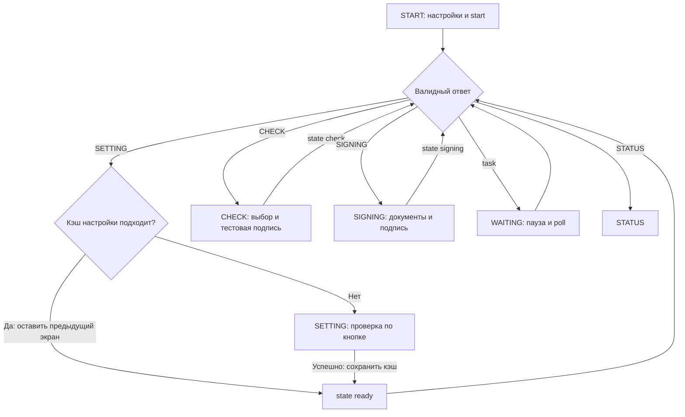

# Простой интерфейс без готовых макетов

Экраны задачи 03 реализованы. Бизнес-содержание определяется требованиями R-* и серверным экраном.

## Общий каркас

Одна страница: краткий заголовок сервиса «Подписание документов», центральная карточка до примерно 720 px, title, message, содержимое текущего шага, зона действий. На узком экране карточка занимает доступную ширину с полями 16 px; кнопки могут располагаться вертикально. Нейтральный фон, чёткий текст, один акцентный цвет; без выдуманной банковской айдентики и стороннего UI-kit.

Внутренняя навигация выбирает компонент по `current.process` из контекста. Например, для `START` отображается экран подготовки. При загрузке приложения `main.tsx` один раз читает `id` из SMS-ссылки и передаёт его в `App`. Переходы внутри процесса используют состояние заявки. Кнопка STATUS с полным URL открывает следующий внешний процесс.

Все компоненты оформляются через `.module.css`; глобально допустимы reset, шрифты и общие CSS-переменные. LESS и произвольные глобальные классы старого криптослоя не переносить.

```text
Подписание документов
┌──────────────────────────────────────────────┐
│ [необязательный шаг из ответа]                │
│ Заголовок                                    │
│ Пояснение                                    │
│                                              │
│ Содержимое текущего процесса                  │
│                                              │
│ [Основное действие]  [Вторичное действие]     │
│ [Идентификатор запроса — только при ошибке]   │
└──────────────────────────────────────────────┘
```

## Состав экранов

| Экран   | Содержимое                                                              | Состояния и действия                                                                                                                   |
| ------- | ----------------------------------------------------------------------- | -------------------------------------------------------------------------------------------------------------------------------------- |
| START   | Локальный текст «Подготавливаем подписание», индикатор                  | Загрузка настроек и start; без фиктивного процента                                                                                     |
| SETTING | title/message и строки из `screen.lists.testing` с серверными подписями | «Запустить проверку» выполняет только указанные известные этапы. Статусы привязаны по имени. При ошибке доступны «Подробнее» и повтор. |
| CHECK   | title/message; сведения о сертификате или select; consent               | Загрузка сертификатов, выбор, подпись, отправка; основной CTA из screen                                                                |
| SIGNING | title/message, optional step; документы; сертификат                     | Открыть/скачать документ, выбрать сертификат, подписать, ожидать отправку                                                              |
| WAITING | Локальный текст «Ожидаем результат обработки», индикатор                | Polling; без выдуманной кнопки отмены серверной заявки                                                                                 |
| STATUS  | level, title/message; accent/secondary                                  | SUCCESS/WARNING/ERROR; url или BACK; request id при ошибке                                                                             |

`RUNNING` для строки SETTING может быть локальным UI-состоянием; не добавлять его в серверный enum без необходимости. Ошибка ранней проверки оставляет последующие строки непроверенными.

### Сертификаты

Один: карточка с ФИО и организацией, используется автоматически. Несколько: доступный с клавиатуры select, сначала «Выберите сертификат». В списке ФИО и организация; для одинаковых подписей допустим краткий серийный номер для различения. Срок действия показывать как дополнительную информацию, если доступен. Не показывать сырой JSON, OID и полный Base64.

### Документы

Строка: название, формат, действие «Открыть документ». Кнопка должна иметь понятное имя, не только стрелку. При загрузке показывать индикатор у строки и не допускать дубликата того же запроса. Для поддерживаемого формата открыть просмотр с явным способом закрыть/вернуться; иначе скачать файл. Ошибка открытия встроенного просмотра должна оставлять способ скачать.

Нативный модальный диалог поверх SIGNING сохраняет рабочий экран и выбор сертификата. Кнопка закрытия и Escape возвращают фокус на кнопку строки. PDF открывается встроенным просмотрщиком браузера, PNG, JPEG, GIF и WebP отображаются через `img`. Для встроенного просмотра MIME и сигнатура байтов должны совпасть. Ссылка «Скачать документ» доступна при любом результате отрисовки.

Расширение `format` приводится к нижнему регистру и используется для определения MIME файла через `mime-db`. Для неизвестного расширения применяется `application/octet-stream`. Имя собирается из очищенного `title` и расширения. Форматы вне списка просмотра, включая DOC, HTML и SVG, скачиваются как бинарные вложения. В диалоге остаётся ссылка для ручного скачивания, если браузер задержит или заблокирует автоматическое. Object URL освобождается при закрытии диалога, замене документа или списка и при уходе с экрана.

Синтетический прогон в Chrome на Windows проверяет встроенный PDF, сохранение файла, отказ просмотра изображения, возврат фокуса и ошибку REST.03. Edge, Firefox, Safari и мобильные браузеры отдельно не прогонялись.

### STATUS и BACK

При недействительной ссылке показать локальный STATUS «Ссылка недействительна» с текстом «Откройте ссылку из SMS». Этот экран не содержит кнопок. Схема серверного STATUS от этого правила не меняется.

Успех — спокойный положительный индикатор; предупреждение и ошибка различаются текстом/символом, а не только цветом. Кнопки брать из ответа; optional secondary не резервирует пустую зону. Если контракт допускает статус без действий, не придумывать кнопку (Q-11).

D-03: BACK восстанавливает последний рабочий экран со снимком данных. WAITING и STATUS не образуют бесконечную историю возвратов. Если рабочего экрана нет, возврат ведёт к START. Возвращение на CHECK/SIGNING не запускает подпись автоматически; возвращение на SETTING сохраняет понятный способ повторить проверку. Для ErrorBoundary сбрасывается состояние границы ошибки; при повторном сбое приложение остаётся в контролируемом fallback.

На STATUS/SUCCESS `timer` задаёт задержку в миллисекундах от показа экрана. По её истечении выполнить распознанное действие `accent` через тот же обработчик, что при клике. Если у основной кнопки нет поддерживаемого действия, сохранить экран. Ручной клик по любой кнопке, смена экрана или заявки и unmount отменяют таймер. Защитить от двойного действия при одновременном клике и срабатывании таймера. На WARNING и ERROR кнопки запускают действия вручную.

## Переходы



Диаграмма показывает диспетчер ответа, а не фиксированную обязательную цепочку SETTING → CHECK → SIGNING. Ошибки всех операций идут через общий обработчик в STATUS; 401 возвращает в START; BACK возвращает к сохранённому экрану.

## Доступность и приёмка макета

- Заголовки и кнопки семантические; видимый focus; управление клавиатурой; label у select.
- Загрузка и изменение результата сообщаются через подходящие aria-live/status; критичная ошибка доступна скринридеру.
- Повторный клик во время подписи/отправки блокируется; лоадер не скрывает объяснение действия.
- Серверные строки рендерятся текстом; `consent.hypertext` превращается в безопасную ссылку без исполнения HTML. Если подстрока не найдена, весь текст остаётся читаемым и ссылка отображается отдельно (D-05).
- В кнопке STATUS поле `url` содержит абсолютный HTTP(S)-адрес следующего процесса. Политика внешних доменов — Q-11.
- Проверить ширины 360, 768 и 1280 px, длинные названия и сообщения, отсутствие horizontal overflow, клавиатуру и возврат из просмотра.
- Подготовить изображения/скриншоты всех экранов и ключевых состояний на синтетических данных. Демонстрационный переключатель допускается только для разработки и не входит в production-навигацию.

## Реализация и проверка задачи 03

Карточка шириной до 720 px, системный шрифт, синий акцент, одна колонка для строк и действий на узком экране. При переходе фокус получает заголовок. SETTING передаёт результат текстом, индикаторы загрузки используют role=status. STATUS выводит X-Request-Id для предупреждения или ошибки, если он получен.

- Каждый экран лежит в своей папке в src/screens. Общий каркас, кнопки и выбор сертификата размещены в screens/shared. Список документов и диалог просмотра лежат рядом с SigningScreen.
- App выбирает экран через useSigningNavigation(), а STATUS вызывает useStatusActions(). ProcessErrorBoundary отображает тот же компонент STATUS и связывает повтор с BACK.
- SettingScreen получает состояние проверки по имени этапа и обработчики запуска и подробностей. После успешных проверок приложение отправляет `ready`.
- CheckScreen и SigningScreen получают состояние поиска, список сертификатов и обработчик подписи. CHECK вызывает `submitCheck`, SIGNING — `submitSigning`. `SigningDocuments` связывает открытие документа с `downloadDocument`. Пустая выборка сертификатов переводит в STATUS по `NO_CERT`.
- Ссылка согласия принимает абсолютный HTTP(S)-адрес. При небезопасном адресе исходный текст сохраняется. Вторичная ссылка рабочего экрана при валидном URL открывается в новой вкладке, сохраняя текущий шаг.

Для ручного просмотра запустить npm run dev и открыть /docs/signing/ui-preview.html на адресе Vite. Сценарий можно указать через параметр ?case=signing. Точка входа фикстур доступна в режиме разработки.

Скриншоты [SETTING](ui-screenshots/setting-error-768.png), [CHECK](ui-screenshots/check-multiple-768.png), [SIGNING](ui-screenshots/signing-768.png), [просмотра документа](ui-screenshots/document-preview-768.png) и [STATUS на 360 px](ui-screenshots/error-360.png). Остальные состояния лежат в каталоге ui-screenshots.

Браузерная проверка запускается с Node.js 22.13+ и Chrome.

```powershell
node docs/signing/check-browser-ui.mjs 'C:/Program Files/Google/Chrome/Application/chrome.exe'
```
